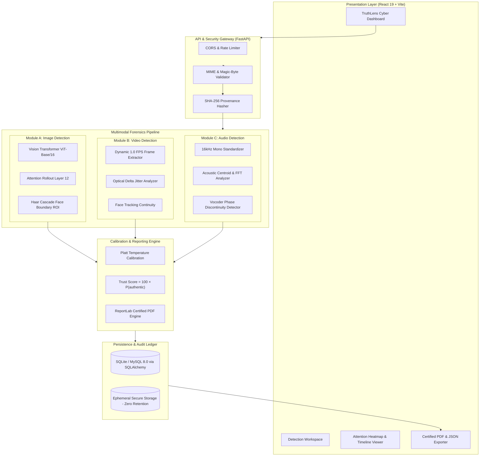
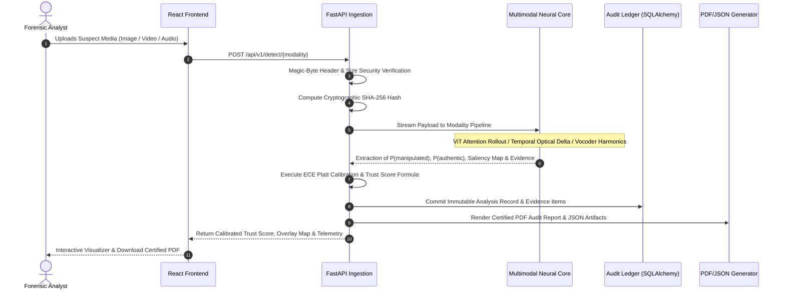
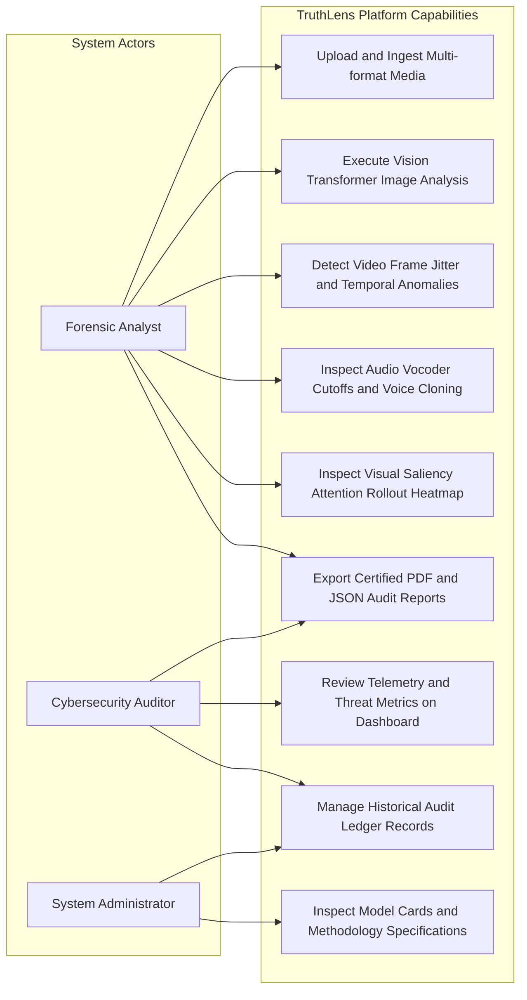
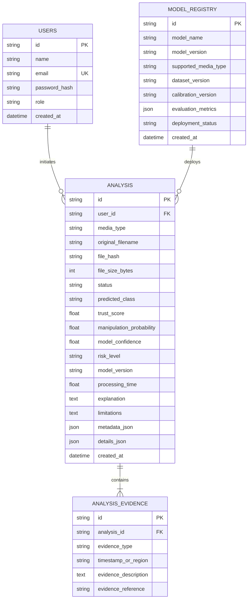

# TruthLens AI — Multimodal Deepfake Detection & Cybersecurity Platform

[](https://fastapi.tiangolo.com)
[](https://react.dev)
[](https://pytorch.org)
[](https://tailwindcss.com)
[](LICENSE)

TruthLens AI is an enterprise-grade, cybersecurity-focused platform engineered to audit uploaded **images**, **videos**, and **speech audio** to evaluate whether they are authentic, AI-generated, or digitally manipulated.

The system utilizes a **Vision Transformer (ViT-Base/16)** visual backbone with **Attention Rollout** attribution, inter-frame temporal continuity modeling, and acoustic spectral resonance analysis to compute a calibrated **Trust Score (0–100)**, explainable evidence localization, and downloadable certified forensic audit reports.

---

## 1. System Architecture Diagram



---

## 2. Forensic Data Flow Diagram



---

## 3. Use Case Diagram



---

## 4. Database Entity-Relationship (ER) Diagram



---

## 5. Quickstart & Windows Setup Instructions

TruthLens AI is fully tested on **Windows 11 / 10** using PowerShell and Python 3.10.

### Prerequisites
- **Python 3.10+** (verify with `py -3.10 --version` or `python --version`)
- **Node.js v18+ & npm** (verify with `node -v` and `npm -v`)

### Step 1: Clone or Navigate to the Repository
```powershell
cd "d:\college work\deepfake detection"
```

### Step 2: Configure Environment Variables
Copy the template `.env.example`:
```powershell
Copy-Item .env.example .env
```

### Step 3: Backend Setup & Execution
Open a PowerShell terminal and launch the FastAPI backend:
```powershell
# Navigate to backend
cd "d:\college work\deepfake detection\backend"

# Install backend dependencies (if not already installed)
py -3.10 -m pip install -r requirements.txt

# Launch FastAPI development server
py -3.10 -m uvicorn app.main:app --host 127.0.0.1 --port 8000 --reload
```
The backend API is now running at:
- **API Gateway:** `http://127.0.0.1:8000`
- **Interactive Swagger Docs:** `http://127.0.0.1:8000/docs`
- **System Health:** `http://127.0.0.1:8000/api/v1/health`

### Step 4: Frontend Setup & Execution
Open a second PowerShell window and launch the React + Vite frontend:
```powershell
# Navigate to frontend
cd "d:\college work\deepfake detection\frontend"

# Install dependencies (if not already installed)
npm install

# Start Vite development server
npm run dev
```
Open your browser to:
👉 **`http://localhost:5173`**

---

## 6. Running Integration Tests

Run the comprehensive integration test suite validating health, model registries, ViT image inference, and dashboard metrics:
```powershell
cd "d:\college work\deepfake detection\backend"
py -3.10 tests/test_api.py
```
Expected output:
```text
[1/5] Running health check...
[2/5] Running model registry test...
[3/5] Running model cards test...
[4/5] Running image detection flow test...
[5/5] Running dashboard stats test...

ALL 5 INTEGRATION TESTS PASSED SUCCESSFULLY! ✓
```

---

## 7. Model Training & Evaluation Workflow

The `ml/` directory contains standalone training scripts adhering to identity-level data splitting to eliminate data leakage:

### Training Vision Transformer (ViT) on Images
```powershell
cd "d:\college work\deepfake detection"
py -3.10 ml/image_training/train_vit.py
```

### Training Temporal Consistency on Videos
```powershell
py -3.10 ml/video_training/train_temporal.py
```

### Training Acoustic Deepfake Detector on Speech
```powershell
py -3.10 ml/audio_training/train_audio.py
```

### Evaluated Metrics
Every model is benchmarked against:
- **Accuracy, Precision, Recall, F1-Score**
- **ROC-AUC (Area Under the Receiver Operating Characteristic)**
- **Brier Score:** \( \text{BS} = \frac{1}{N} \sum (p_i - y_i)^2 \)
- **Expected Calibration Error (ECE):**
  $$ \text{ECE} = \sum_{m=1}^{M} \frac{|B_m|}{N} \left| \text{acc}(B_m) - \text{conf}(B_m) \right| $$

---

## 8. Calibrated Trust Score Formulation

TruthLens AI calculates an understandable, calibrated metric distinguishing class probability from model uncertainty:

$$ P(\text{authentic} \mid x) = 1.0 - P(\text{manipulated} \mid x) $$
$$ \mathbf{\text{Trust Score}} = 100 \times P(\text{authentic} \mid x) $$

### Decision Brackets
| Score Range | Calibrated Classification | Recommended Action |
|:---:|:---|:---|
| **80 – 100** | Higher Estimated Authenticity | Low Risk; organic noise pattern verified. |
| **60 – 79** | Moderate Estimated Authenticity | Normal distribution with minor compression blur. |
| **40 – 59** | **Inconclusive / Mixed Evidence** | Ambiguous signatures; manual forensic inspection advised. |
| **20 – 39** | Elevated Manipulation Indicators | High synthesis probability; anomalous patch boundaries isolated. |
| **0 – 19** | Strong Manipulation Indicators | Critical threat; multiple synthetic vocoder/diffusion markers detected. |

---

## 9. Cybersecurity Controls & Verification

| Threat Vector | Mitigation in TruthLens AI |
|:---|:---|
| **Extension Camouflage** | Magic-byte signature verification (`b"\xff\xd8\xff"`, `b"\x89PNG"`, `b"ftyp"`, `b"RIFF"`). |
| **Decompression Bomb DOS** | Hard cap at 50,000,000 pixels (`Image.MAX_IMAGE_PIXELS`). |
| **Path Traversal Attacks** | UUID server-generated filenames and regex filename sanitization. |
| **Media Retention Leakage** | Ephemeral file processing with automatic `Path.unlink()` post-inference. |
| **SQL Injection** | Parameterized SQLAlchemy ORM query construction. |
| **Information Disclosure** | Global exception handlers prevent sensitive stack traces in HTTP responses. |

---

## 10. Docker Deployment

To launch the full production stack including MySQL 8.0, Backend, and Nginx Frontend:
```bash
docker compose up --build -d
```
Access the application at `http://localhost:5173` and the API at `http://localhost:8000`.

---

## 11. Project Directory Structure

```text
d:\college work\deepfake detection/
├── frontend/                     # React 19 + Vite + Tailwind CSS Frontend
│   ├── src/
│   │   ├── api/client.js         # Axios API Client
│   │   ├── components/           # Reusable Cyber Forensic Components
│   │   │   ├── Navbar.jsx
│   │   │   ├── Footer.jsx
│   │   │   ├── TrustScoreGauge.jsx
│   │   │   ├── RiskBadge.jsx
│   │   │   ├── AttentionHeatmapViewer.jsx
│   │   │   ├── FrameTimelineChart.jsx
│   │   │   ├── AudioTimelineChart.jsx
│   │   │   ├── EvidenceCard.jsx
│   │   │   └── ModelInfoCard.jsx
│   │   ├── pages/                # 6 Main Application Pages
│   │   │   ├── LandingPage.jsx
│   │   │   ├── DetectionWorkspace.jsx
│   │   │   ├── AnalysisResults.jsx
│   │   │   ├── Dashboard.jsx
│   │   │   ├── AnalysisHistory.jsx
│   │   │   └── Methodology.jsx
│   │   ├── App.jsx
│   │   └── index.css
│   └── package.json
├── backend/                      # Python FastAPI Forensics Core
│   ├── app/
│   │   ├── api/v1/endpoints/     # Detect, Analysis, Models, Health
│   │   ├── core/                 # Config, Cryptography, Magic Bytes
│   │   ├── database/             # SQLAlchemy Models & Sessions
│   │   ├── detectors/            # Real ViT Image, Video, & Audio Detectors
│   │   ├── preprocessing/        # OpenCV, Face Cascade, SoundFile, PIL
│   │   ├── schemas/              # Pydantic Schemas
│   │   ├── services/             # ReportLab PDF & JSON Generator
│   │   └── main.py               # FastAPI App Entrypoint
│   ├── tests/test_api.py         # End-to-end Integration Test Suite
│   └── requirements.txt
├── ml/                           # Training Pipelines & Model Cards
│   ├── image_training/train_vit.py
│   ├── video_training/train_temporal.py
│   └── audio_training/train_audio.py
├── reports/                      # Generated Certified PDF & JSON Audits
├── docker-compose.yml
├── Dockerfile.backend
├── Dockerfile.frontend
├── .env.example
├── .gitignore
└── README.md
```

---

## 12. Ethical & Legal Disclaimer

TruthLens AI is an auxiliary analytical tool designed for cybersecurity, media forensics, and verification workflows. Output scores represent statistical probability distributions and do not constitute irrefutable proof or a judicial determination of source identity. Forensic analysts must always corroborate algorithmic findings with certified human oversight.
